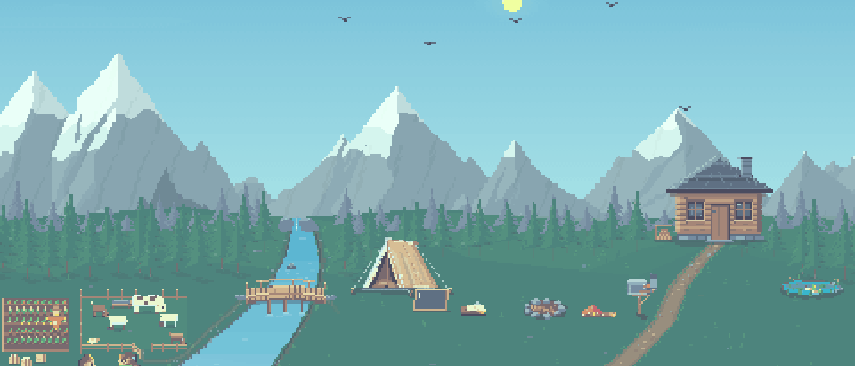

<picture><source media="(prefers-color-scheme: dark)" srcset="assets/valley-night.gif"></picture>

# Divyansh Sharma

AI systems builder and AI automation developer in Jaipur, Rajasthan, India. I build automations, custom tools, portals, AI content systems and websites for businesses, all running at zero or near-zero marginal cost.

🌄 **[Visit my website](https://www.divyanshsharma.me)**

🏕️ the tent

I build systems that let founders step away from the keyboard: no metered APIs unless there is no free alternative, and no infrastructure I cannot run myself. I lean on `claude -p` as the AI engine inside my pipelines, so things cost nothing per run.

🔥 the campfire

- **Automations**: End-to-end workflow automation and background pipelines that take repetitive manual work off your plate.
- **Custom tools and portals**: Custom business tools, internal portals and ERP systems built around specific business operations.
- **AI content systems**: Autonomous AI content systems and repurposing pipelines running reliably without metered API bills.
- **Websites**: Fast website development, static web applications and technical SEO architecture built for performance.

📜 the letter on the log

### What have I done?

- 🧭 [fable-toolkit](https://github.com/ddivyanshsharmaa/fable-toolkit): six skills and four agents for Claude Code built around one behaviour: finish the job, then prove it works. Plus multi-engine loops that hand implementation to Codex or Gemini while Claude orchestrates and reviews.
- 🔊 [audio-splitter](https://github.com/ddivyanshsharmaa/audio-splitter): play the same audio through a wired and a Bluetooth speaker at once, in sync, on Windows. No virtual driver install, no reboot.
- ⌨️ [hotkey-hq](https://github.com/ddivyanshsharmaa/hotkey-hq): every shortcut competing for a key on your Windows machine, on one keyboard you can press keys against. Answers: who is eating this key?

🪵 the cabin

Most of the rest is private client or product work: a learning-centre ERP running on static HTML and Postgres row-level security, Repurpose Studio, Greenlight, SEO Autopilot, Sage Agent MCP and the others are written up on [divyanshsharma.me](https://www.divyanshsharma.me).

**What I build with**: Python · Node.js · Claude headless CLI · Supabase · SQLite · scikit-learn · Express · WordPress/PHP · technical SEO

📖 the book

I write about systems, attention and building at [divyanshsharma.me/blog](https://www.divyanshsharma.me/blog/).

📬 the mailbox

Taking a couple of client projects a month.

Email: [divyanshsharma7117@gmail.com](mailto:divyanshsharma7117@gmail.com)

Website: [divyanshsharma.me](https://www.divyanshsharma.me)

[LinkedIn](https://www.linkedin.com/in/ddivyanshsharmaa/) · [Substack](https://substack.com/@divyanshsharmaa) · [X](https://x.com/divyanshsharmar)

